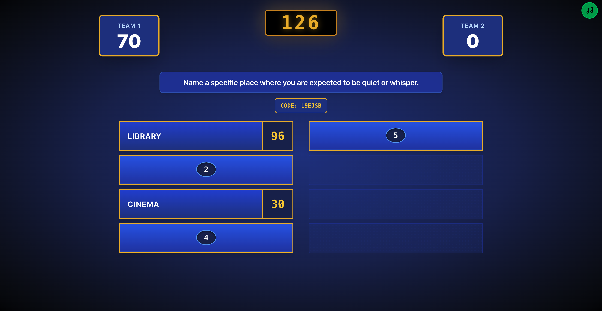
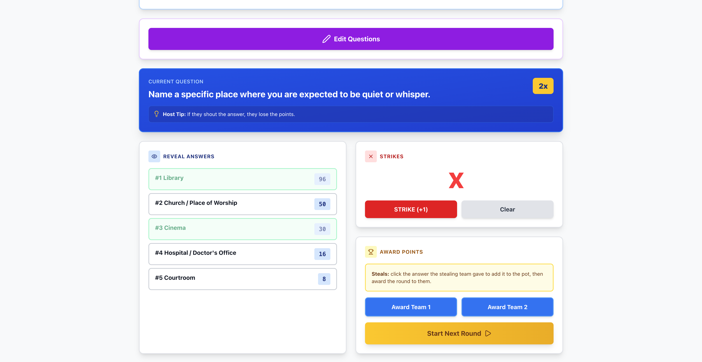
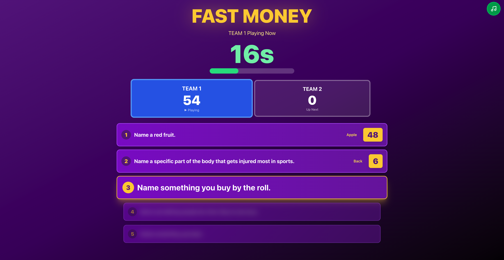

# Family Feud

A Family Feud style game show for game nights. The board is displayed on a screen that everyone can see, you run the game from your phone, and the two stay in sync through Firebase.

**Live:** https://familyfeud-self.vercel.app

## Screenshots



<p>
  
  
</p>

## How it works

Two screens:

- **Board**: Shows the question, the answers as they're revealed, the scores, and any strikes complete with sound effects and theme music. Open it on a screen everyone can see.
- **Host controls**: Reveal answers, give strikes, award points, edit the questions, and start Fast Money. Can be run on a phone or tablet, so you can walk around and interact with the players.

Creating a game gives you a session code for the board and a host code for you. Anyone with the session code can watch, but only someone with the host code can change anything about the game.

There are three rounds by default, worth 1x, 2x and 3x points. Three strikes and the other team gets one chance to steal the pot.

Fast Money is an optional final round. The team that won the main game gets 45 seconds for five questions, then the other team gets 30 seconds with the same questions in a different order. The second team can't repeat an answer the first team gave, and the higher total wins.

## Running it locally

You'll need Node.js and a Firebase project with:

- a Realtime Database, started in locked mode, with the rules from `database.rules.json` deployed
- Anonymous sign-in enabled under Authentication
- a web app registered, for the client config

Copy `.env.example` to `.env.local` and paste in your values:

| Variable | What it is |
|----------|------------|
| `NEXT_PUBLIC_FIREBASE_API_KEY` | From the web app config |
| `NEXT_PUBLIC_FIREBASE_AUTH_DOMAIN` | From the web app config |
| `NEXT_PUBLIC_FIREBASE_DATABASE_URL` | From the web app config, or the top of the Realtime Database page |
| `NEXT_PUBLIC_FIREBASE_PROJECT_ID` | From the web app config |
| `NEXT_PUBLIC_FIREBASE_STORAGE_BUCKET` | From the web app config |
| `NEXT_PUBLIC_FIREBASE_MESSAGING_SENDER_ID` | From the web app config |
| `NEXT_PUBLIC_FIREBASE_APP_ID` | From the web app config |

Then:

```bash
npm install
npm run dev
```

To try it on one machine, open the host controls and the board in separate windows. To use your phone as the host, open the dev server using your computer's local IP rather than localhost.

## Making a game

You can change the questions for a single game with **Edit Questions** on the host controls. Those changes are saved to that session and cleared when the game is reset.

To change the defaults for every new game, edit `src/lib/gameData.ts`:

```ts
export const INITIAL_ROUNDS: Round[] = [
  {
    title: "Round 1: Lost & Found",
    question: "Name something people frequently lose or misplace around the house.",
    multiplier: 1,
    hostTip: "Check your pockets before answering!",
    answers: [
      { text: "Keys", points: 32, revealed: false },
      { text: "TV Remote", points: 24, revealed: false },
      { text: "Phone", points: 18, revealed: false },
    ],
  },
];

export const FAST_MONEY_QUESTIONS: FastMoneyQuestion[] = [
  {
    question: "Name a red fruit.",
    answers: [
      { text: "Apple", score: 48 },
      { text: "Strawberry", score: 26 },
      { text: "Cherry", score: 12 },
    ],
  },
];
```

- `INITIAL_ROUNDS`: played in order. Fast Money is offered on the last one.
- `title`: a label for the round. It isn't shown in the game.
- `multiplier`: 1, 2 or 3. The points on the board are multiplied by this.
- `hostTip`: only shown on the host controls.
- `answers`: up to 8, shown in the order listed, so put the most popular first. `revealed` should start as `false`.
- `FAST_MONEY_QUESTIONS`: every question is used, usually five. Each answer's `score` is what the player gets if they give it.

## Running a game

1. Click **Create New Game**. You'll land on the host controls with the session code and host code.
2. On the TV or laptop, enter the session code and click **Join as Board**. You can also open the link from **Copy Link** or scan the QR code.
3. Read out the question. When someone gives an answer that's on the board, click it under **Reveal Answers** to flip it and add its points to the pot.
4. Wrong answers get a **Strike**. After three, the other team can steal: if their answer is on the board, reveal it and award the round to them.
5. Click **Award Team 1** or **Award Team 2** to bank the pot, then **Start Next Round**.
6. On the last round, click **End Game** for the winner screen or **Start Fast Money**.
7. In Fast Money, click the answer each player gives (or **No Answer / Pass**) and the next question comes up. When the first team finishes or runs out of time, switch to the other team, then hit **Reveal Winner**.

If you close the host tab, go back to the site and log in with the host code to pick up where you left off. If the board gets refreshed, join again with the session code.
